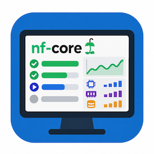
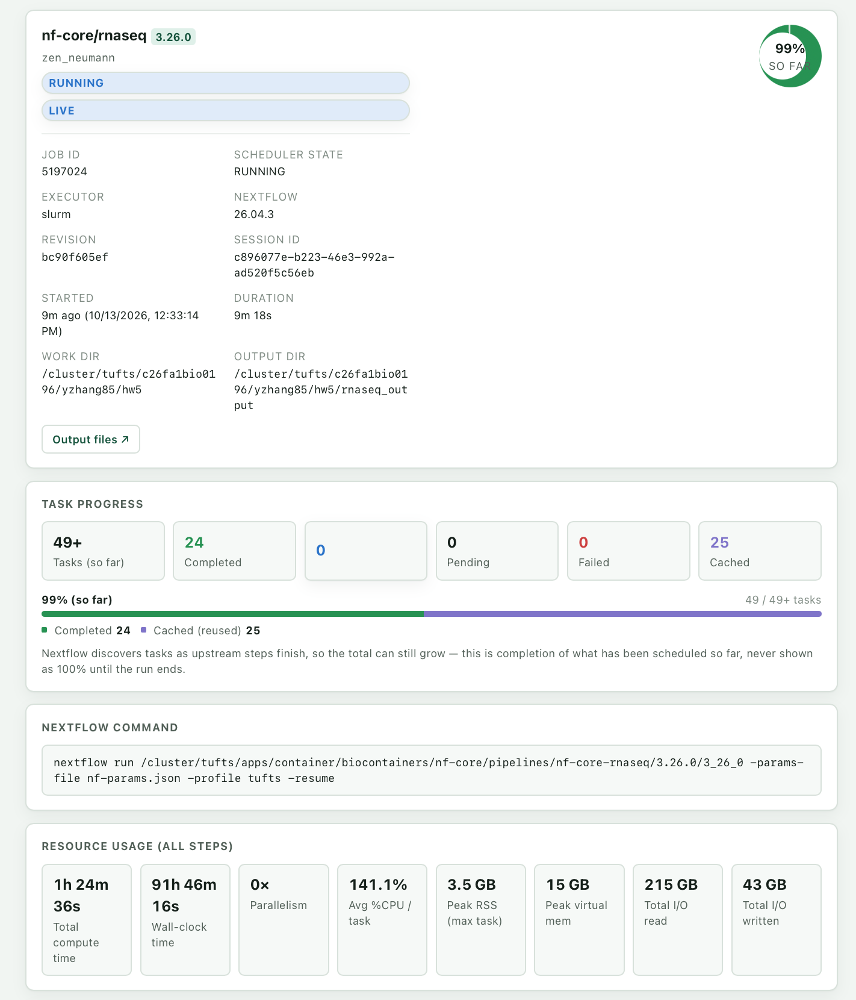
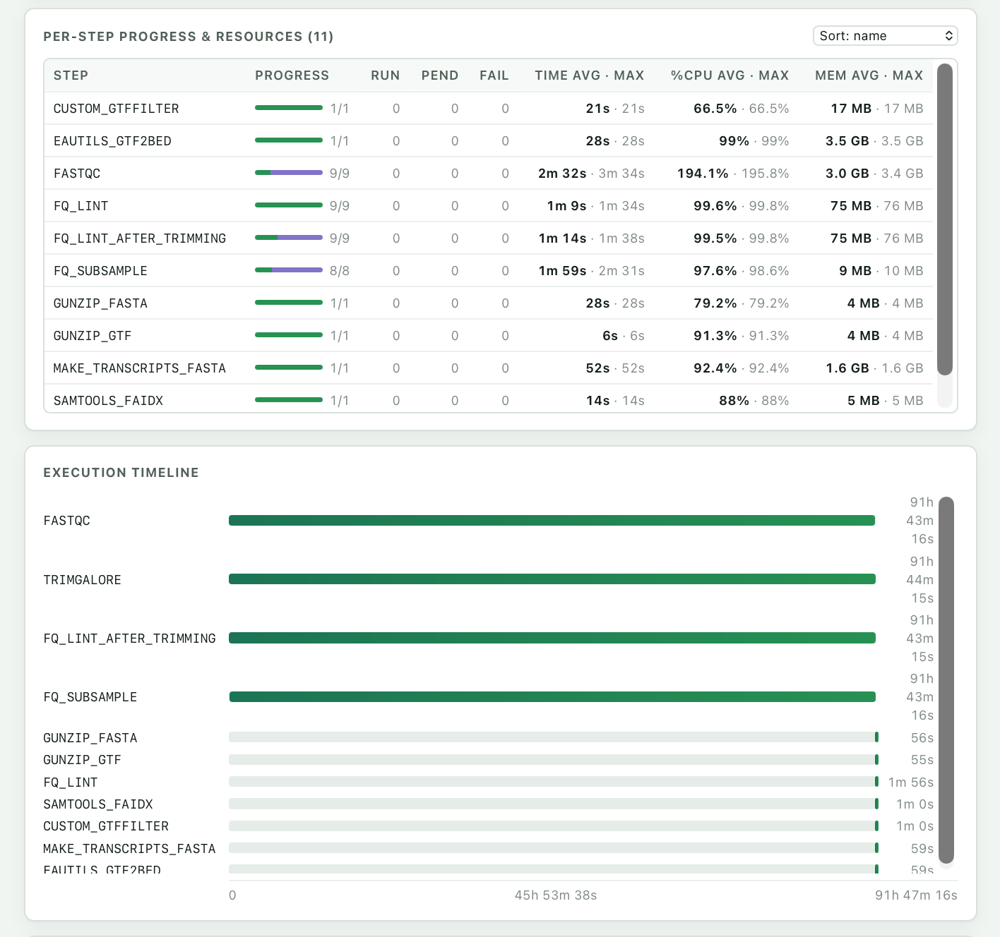

<p align="center">
  
</p>

<h1 align="center">nf-core Pipeline Monitor</h1>

<p align="center">
  A Nextflow-Tower-style dashboard, built into Open OnDemand, for the
  <a href="https://nf-co.re/">nf-core</a> pipelines your users launch from Open OnDemand.
</p>

<p align="center">
  
  
  
</p>

## Overview

Researchers often launch nf-core pipelines (rnaseq, sarek, atacseq, …) from
Open OnDemand Batch Connect forms. After submitting, they usually see only a Slurm job ID
and a log file. **nf-core Pipeline Monitor** is an Open OnDemand Passenger app
(`role: web`) that turns those runs into a live dashboard.

**Who it's for:**

- **End users** who want to know how far along their pipeline is and what failed,
  without going through `work/` directories or `squeue` output.
- **HPC centers** that already provide nf-core pipelines as Open OnDemand apps and
  want a monitoring view with no extra infrastructure.

The app has **no database, no daemon, and does not change your pipeline apps.**
It only reads files that already exist under the user's own account. That means it
also works retroactively for runs that finished before the app was installed.

## Screenshots

**Run overview.** Shows live status, run metadata, task progress (completed vs. cached
tasks from `-resume`), the exact `nextflow run` command, and resource usage across all steps.

<p align="center">
  
</p>

**Per-step progress and execution timeline.** Shows progress, time, %CPU and memory
(average and maximum) for every pipeline step, plus a Gantt-style timeline.

<p align="center">
  
</p>

## Features

- **Run list.** Shows every nf-core run the user launched through Open OnDemand, newest first,
  with live status (pending / running / succeeded / failed) and a progress bar per run.
- **Run detail view**
  - Run metadata: pipeline and version, run name, Slurm job ID and state, executor,
    Nextflow version, revision, session ID, start time, duration, and work/output directories
  - Live task progress, split into completed, running, pending, failed, and cached
    (reused by `-resume`) tasks. The total is labeled "so far" while Nextflow is still
    discovering tasks.
  - The exact `nextflow run` command that was launched
  - Resource usage across all steps: total compute time, wall-clock time, parallelism,
    average %CPU, peak RSS and virtual memory, and total I/O read/written
  - A sortable per-step table showing progress, run/pending/fail counts, and average and maximum time, %CPU and memory for each step
  - Execution timeline per step
  - Failed-task panel, with links to each task's `work/` directory in the OnDemand Files app
  - Recent tasks, pipeline parameters, and software versions
  - A live tail of the pipeline's `output.log`
- **One-click reports.** Opens Nextflow's execution report, timeline, DAG, and the
  MultiQC report directly in the browser. The **Output files** button opens the output
  directory in the OnDemand Files app.
- **Auto-refresh.** Updates every 15 s by default; the interval can be changed in the UI.

## Requirements

| Component | Requirement |
|-----------|-------------|
| Open OnDemand | **4.0 or newer**. Older versions are untested. |
| Ruby | The Ruby that ships with Open OnDemand 4.x, with the `sinatra` gem available to Passenger |
| Scheduler | **Slurm.** `squeue` and `sacct` must be on the `PATH` of the user's PUN |
| System tools | GNU coreutils `timeout` |
| Pipelines | One or more Open OnDemand Batch Connect apps for nf-core whose app directory name starts with `nf-core-` (see below) |

### What the monitor expects from your nf-core Batch Connect apps

The monitor finds runs by scanning the Open OnDemand session directories of every
Batch Connect app whose directory matches `nf-core-*`:

```
~/ondemand/data/sys/dashboard/batch_connect/{sys,dev,usr}/nf-core-*/output/<session_id>/
```

For each session, it reads:

| Source | Field | Used for |
|--------|-------|----------|
| `connection.yml` | `working_path` | Nextflow launch directory (falls back to the `workdir` form field, then `$HOME`) |
| `connection.yml` | `output_log_path` | Log tail (falls back to `<session>/output.log`) |
| `user_defined_context.json` | `outdir` | Pipeline `--outdir` (relative paths resolve against the launch dir; default `results`) |
| `user_defined_context.json` | `executor` | Shown in the UI |
| `<launch dir>/.nextflow/history` | — | Run name, OK/ERR status, duration |
| `<outdir>/pipeline_info/` | `execution_trace_*.txt`, `execution_report_*.html`, `execution_timeline_*.html`, `pipeline_dag_*.html`, `params_*.json`, software versions | Progress, per-process stats, reports |
| `<outdir>/multiqc/**/multiqc_report.html` | — | MultiQC link |

nf-core pipelines write `pipeline_info/` by default, so nothing needs to change in the
pipelines themselves. If your Batch Connect apps use different form field names
for the output or work directory, adjust `run_context` in `app.rb` (see
[Configuration](#configuration)).

## Installation

Run these steps as an Open OnDemand administrator on the OnDemand web host.

1. **Clone the app into the system apps directory.** The directory **must** be named
   `nf_monitor`, because the app's routes are mounted under `/pun/<env>/nf_monitor`.

   ```bash
   cd /var/www/ood/apps/sys
   sudo git clone https://github.com/TuftsRT/ood-nfcore-monitor.git nf_monitor
   # Optional: pin to a tagged release
   # sudo git -C nf_monitor checkout v1.0.0
   ```

2. **Make sure Sinatra can be loaded.** Check with the same Ruby that Passenger uses:

   ```bash
   ruby -e 'require "sinatra/base"; puts Sinatra::VERSION'
   ```

   If this fails, install the gem for that Ruby, either system-wide
   (`gem install sinatra`) or vendored inside the app directory with a `Gemfile`
   and `bundle config set --local path vendor/bundle && bundle install`.

3. **Check that Slurm is reachable** from a user's PUN (log in to OnDemand as a
   test user, open a shell, and run `squeue -u $USER` and `sacct -X -n`).

4. **Open the app.** It appears in the dashboard under
   *Interactive Apps → Bioinformatics* (set in `manifest.yml`), or directly at:

   ```
   https://<your-ondemand-host>/pun/sys/nf_monitor
   ```

5. **Verify.** Launch any nf-core Batch Connect app and confirm the run appears in the
   list within one refresh cycle. Its progress bar should move once Nextflow starts
   writing `execution_trace_*.txt`.

### Trying it as a developer (sandbox) app

If developer mode is enabled at your site, you can test without root:

```bash
mkdir -p ~/ondemand/dev
git clone https://github.com/TuftsRT/ood-nfcore-monitor.git ~/ondemand/dev/nf_monitor
```

Then open `https://<your-ondemand-host>/pun/dev/nf_monitor`.

### Updating

```bash
cd /var/www/ood/apps/sys/nf_monitor
sudo git pull            # or: sudo git checkout <new-tag>
touch tmp/restart.txt    # optional; users can also restart their web server from the Help menu
```

## Configuration

All site-specific values are constants near the top of `app.rb`:

| Constant / location | Default | Purpose |
|---------------------|---------|---------|
| `APP_GLOB` | `"nf-core-*"` | Glob matching the directory names of your nf-core Batch Connect apps. Change it if your apps use a different prefix. |
| `ENVS` | `%w[sys dev usr]` | Open OnDemand deployment environments to scan for sessions |
| `BC_ROOT` | `~/ondemand/data/sys/dashboard/batch_connect` | Open OnDemand Batch Connect data root (change only if you've relocated `OOD_DATAROOT`) |
| `SQUEUE_TIMEOUT` / `SACCT_TIMEOUT` | `15` s | Upper bound on each scheduler call, so a slow scheduler can't hang a web worker |
| `LOG_TAIL_LINES` / `LOG_TAIL_BYTES` | `200` lines / 128 KiB | Size of the log tail shown in the detail view |
| `REPORT_GLOBS` | report / timeline / DAG | File patterns for Nextflow HTML reports under `pipeline_info/` |
| `run_context` (method) | `working_path`, `outdir`, `executor`, `workdir` | Mapping from your Batch Connect form fields to launch/output dirs |
| Refresh interval (`<select>` in the inline UI) | 15 s | Default auto-refresh period in the browser |
| `manifest.yml` | Interactive Apps → Bioinformatics | Where the app appears in the dashboard menu |

## How it works

1. **Discover.** Lists the user's nf-core sessions from Open OnDemand's on-disk session
   directories. These last longer than the rotating `batch_connect/db/` index.
   When the `db/<session_id>` record still exists, it supplies the Slurm job ID.
2. **Parse Nextflow artifacts.** Reads `.nextflow/history` and the
   `pipeline_info/` directory. Nextflow writes the trace file *incrementally* while
   the run is in progress, so progress and per-process stats are live.
3. **Get live scheduler state.** One `squeue -u $USER` call covers the whole run list.
   The detail view upgrades a single run with a precise `sacct -X` lookup.
   Once a run ends, Nextflow's own OK/ERR result takes precedence.
4. **Render.** The browser polls a small JSON API and draws the list and detail views.
   The whole UI is inline in `app.rb`, with no external assets or CDN calls.

### API

| Endpoint | Returns |
|----------|---------|
| `GET /api/runs` | All of the user's nf-core runs (summary + task counts) |
| `GET /api/runs/:id` | Full detail for one run (`:id` is the session UUID) |
| `GET /report/:id/:key` | A Nextflow / MultiQC HTML report (`key` ∈ `report`, `timeline`, `dag`, `multiqc`) |

Every route is registered both bare and under `/pun/:env/nf_monitor/...`, so it works
whether or not the proxy strips `SCRIPT_NAME`.

## Security

- Everything runs as the logged-in user inside their own PUN. The app cannot see other
  users' files or jobs.
- Every file path is built from the user's **own** Open OnDemand session records, never from
  request input. Request input is limited to a UUID-validated session ID and a
  report key from a fixed allow-list.
- Job IDs are validated as digits. `squeue`/`sacct` are called with argv arrays (never
  a shell string) and wrapped in `timeout`.
- HTML reports are served with a `text/html` content type, so they render in the browser.
  Open OnDemand's Files app serves user HTML as `text/plain`, which is why the app
  serves them itself. Only files resolved from the run's own
  `pipeline_info/` or `multiqc/` directory can be served.

## Known limitations

- **Slurm only.** Live job state uses `squeue`/`sacct`. On other schedulers, status
  still comes from `.nextflow/history`, but pending/running detection won't work.
- **Shared launch directories.** If several runs share one launch directory, each
  session is matched to the `.nextflow/history` entry whose start time is closest to
  the Open OnDemand submission time. This is a heuristic. Separate output directories per run
  avoid the ambiguity.
- **Deleted outputs.** If a run's `pipeline_info/` was removed, its task table can't be
  rebuilt (counts show 0). Status still comes from `.nextflow/history`.
- **Update lag.** Nextflow flushes the trace file as tasks finish, so expect
  updates to lag by seconds to minutes.
- **Only Open OnDemand-launched runs.** Pipelines started from a terminal or `sbatch` script
  don't have Open OnDemand session records and won't appear.

## Troubleshooting

| Symptom | Likely cause / fix |
|---------|--------------------|
| App fails to start with `cannot load such file -- sinatra/base` | Install the `sinatra` gem for Passenger's Ruby (see Installation step 2) |
| 404 or blank page when opening the app | Make sure the app directory is named exactly `nf_monitor` |
| No runs listed | Your Batch Connect apps don't match `nf-core-*`. Update `APP_GLOB` |
| Runs listed but always 0 tasks | `outdir` doesn't resolve to the real `--outdir`. Check the form field names in `run_context` |
| Status stuck on "unknown" for running jobs | `squeue`/`sacct` not on the PUN `PATH`, or slower than the timeout |
| Changes to `app.rb` not visible | Restart the web server (*Help → Restart Web Server*) or `touch tmp/restart.txt` |

Passenger and app errors are logged to
`/var/log/ondemand-nginx/<user>/error.log` on the OnDemand host.

## Repository layout

| File | Purpose |
|------|---------|
| `app.rb` | Sinatra app: discovery/parsing backend plus the inline HTML/CSS/JS UI |
| `config.ru` | Rack entry point |
| `manifest.yml` | Open OnDemand app metadata (`role: web`) |
| `appverse.yml` | Open OnDemand Appverse catalog metadata |
| `icon.png` | Dashboard icon |
| `docs/` | Screenshots used in this README |

## Testing

Deployed at **Tufts University Research Technology** (cluster *Pax*) on
**Open OnDemand 4.0 and later**. Validated against 131 real nf-core sessions. Tests covered:

- Directory-based discovery (about 1.7 s for the full list)
- Trace parsing, e.g. a 388-task rnaseq run with 42 processes and 9 failed tasks, including the resource totals
- Report-link generation and log tailing
- The full route flow via `Rack::MockRequest`: both URL forms, plus 400/404 responses for bad or missing IDs

## Support & contributing

- Report bugs and request features in the
  [GitHub issues](https://github.com/TuftsRT/ood-nfcore-monitor/issues).
- Pull requests are welcome. Please describe what you changed and how you tested it.

Maintained by **Tufts University Research Technology**.

## License

[MIT](LICENSE) © 2026 Tufts University Research Technology

## Acknowledgments

- [Open OnDemand](https://openondemand.org/) (Ohio Supercomputer Center)
- [Nextflow](https://www.nextflow.io/) and the [nf-core](https://nf-co.re/) community
- Inspired by [Seqera Platform (Nextflow Tower)](https://seqera.io/platform/)
